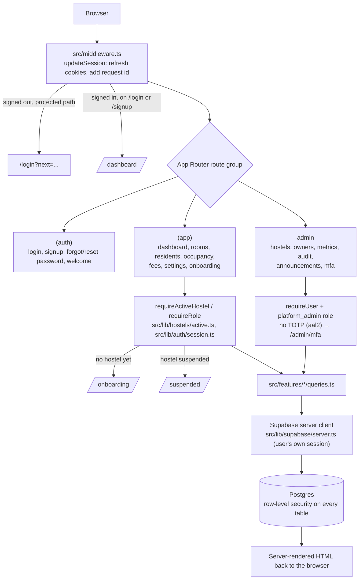
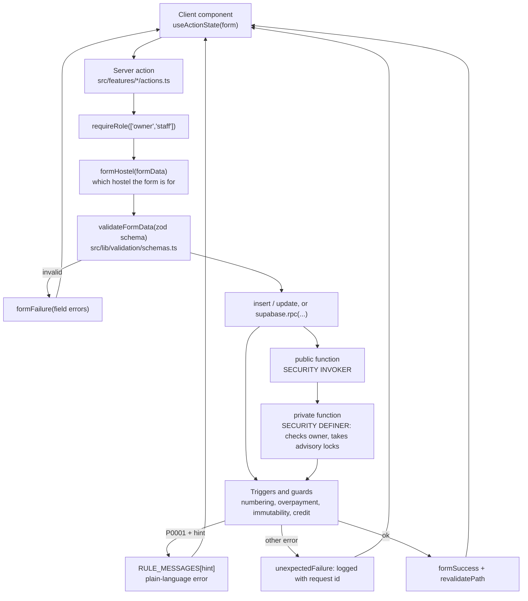
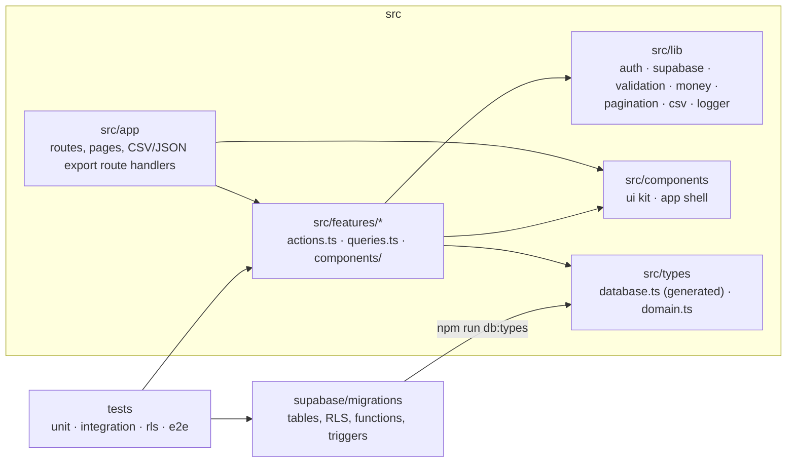
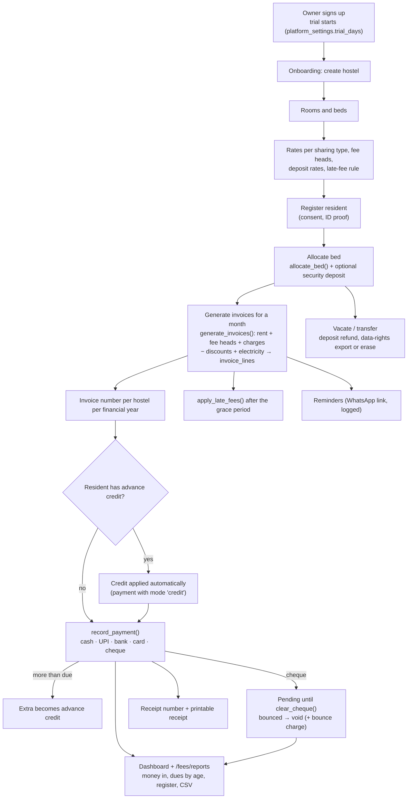
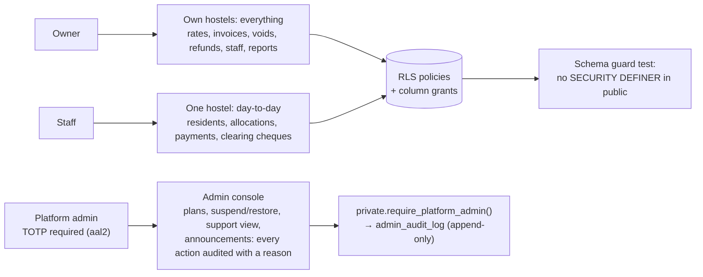
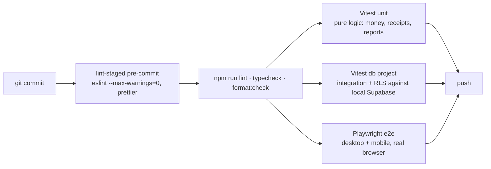

# How the code works

Six flowcharts of Hostel ERP:

1. How a request moves through the app.
2. How a form saves.
3. Where code lives.
4. How a hostel's money flows.
5. Who can reach what.
6. How a change is checked.

The data model is in [database.md](database.md) and the admin console in
[admin.md](admin.md).

The stack is Next.js 15 (App Router, server components and server actions) on
Supabase: Postgres, Auth and Storage. Most of the rules live in the database,
so the app cannot get around them.

## 1. A page request

## 2. A form that saves something

## 3. Where code lives

The areas under `src/features` are:

- rooms, residents, allocations and occupancy;
- fees, charges, deposits and notifications (reminders);
- staff, dashboard, import, data-rights, referrals and announcements;
- admin, hostels and auth.

## 4. A hostel's money, start to finish

## 5. Who can reach what

## 6. How a change is checked

